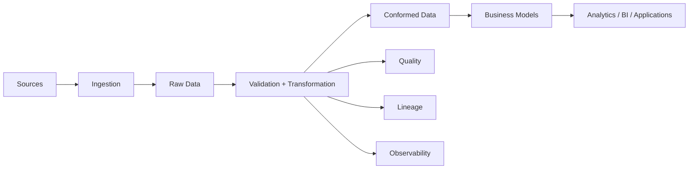

<div align="center">


### Matthew Smith · Data Engineer

`Python · SQL · Spark · Lakehouse · ETL/ELT · Data Modeling`

<a href="https://matthewsmithsoftware.com">
  
</a>

<a href="https://linkedin.com/in/mattmarcussmith">
  
</a>

</div>

---

## `DATA ENGINEERING`

I build data systems around durable engineering principles rather than a single platform.

My focus is on moving data from raw operational sources into reliable, well-modeled, business-ready datasets.

```text id="lugmio"
SOURCE DATA
    ↓
INGEST
    ↓
VALIDATE
    ↓
STANDARDIZE
    ↓
TRANSFORM
    ↓
MODEL
    ↓
SERVE
```

Core areas:

* Data pipelines
* ETL / ELT
* Lakehouse architecture
* Medallion architecture
* Data modeling
* SQL development
* Python / PySpark
* Data quality
* Data lineage
* Data governance
* Orchestration
* Observability
* Incremental processing
* Reliable data products

---

## `MEDALLION ARCHITECTURE`

<div align="center">


</div>

```text id="y59ne2"
BRONZE
Raw / source-aligned
        ↓
SILVER
Validated / standardized / conformed
        ↓
GOLD
Modeled / aggregated / business-ready
```

The principle is more important than the platform:

**data quality and business meaning increase as data moves through the system.**

---

## `ENGINEERING PRINCIPLES`

```text id="nr94w4"
01  Preserve source fidelity

02  Define explicit schemas and contracts

03  Validate before promoting data

04  Make transformations deterministic

05  Design pipelines for idempotency

06  Separate raw, refined, and serving concerns

07  Preserve lineage and operational metadata

08  Make failures observable

09  Design for safe reprocessing

10  Model data around downstream consumption

11  Treat data quality as part of the pipeline

12  Build reusable data products
```

---

## `PLATFORM EXPERIENCE`

I apply the same architectural principles across modern data platforms.

<table>
<tr>

<td width="50%" valign="top">

### Databricks

* Lakehouse architecture
* Medallion design
* Delta Lake
* Apache Spark
* PySpark
* Spark SQL
* Notebook workflows
* Data transformation
* Incremental processing
* Data quality patterns

</td>

<td width="50%" valign="top">

### Microsoft Fabric

* OneLake
* Fabric Lakehouse
* Delta tables
* Data pipelines
* Notebooks
* Python / PySpark
* Spark SQL
* Medallion architecture
* Data transformation
* Serving and analytical layers

</td>

</tr>
</table>

<div align="center">


</div>

---

## `PYTHON + SQL`

<div align="center">


</div>

```text id="om85gy"
PYTHON / PYSPARK
├── ingestion
├── transformation
├── validation
├── automation
└── distributed processing

SQL
├── transformation
├── modeling
├── aggregation
├── validation
└── analytical serving
```

---

## `DATA PLATFORM FOUNDATION`



Regardless of platform, I look for the same fundamentals:

* clear contracts
* reliable ingestion
* reproducible transformations
* scalable processing
* governed storage
* reusable models
* trusted outputs

---

## `DATA TOOLKIT`

<div align="center">


</div>

<table>
<tr>

<td width="33%" valign="top">

### Languages

Python
SQL
PySpark

</td>

<td width="33%" valign="top">

### Platforms

Databricks
Microsoft Fabric
Azure
Spark
Delta Lake

</td>

<td width="33%" valign="top">

### Databases

SQL Server
PostgreSQL

</td>

</tr>
</table>

Supporting experience:

`C# · .NET · Entity Framework Core · ADO.NET`

---

## `CURRENT FOCUS`

<div align="center">


</div>

Current areas of concentration:

* Lakehouse architecture
* Medallion architecture
* Databricks
* Microsoft Fabric
* Python
* PySpark
* SQL
* Apache Spark
* Delta Lake
* ETL / ELT
* Data modeling
* Data quality
* Data lineage
* Data governance
* Pipeline orchestration

---

<div align="center">

### `BUILD TRUSTED DATA SYSTEMS.`

`INGEST · REFINE · MODEL · GOVERN · SERVE`

<br/><br/>

<a href="https://matthewsmithsoftware.com">
  
</a>

</div>
