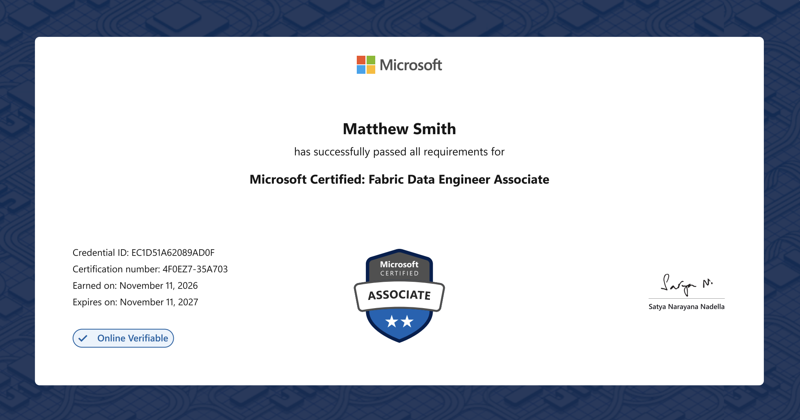
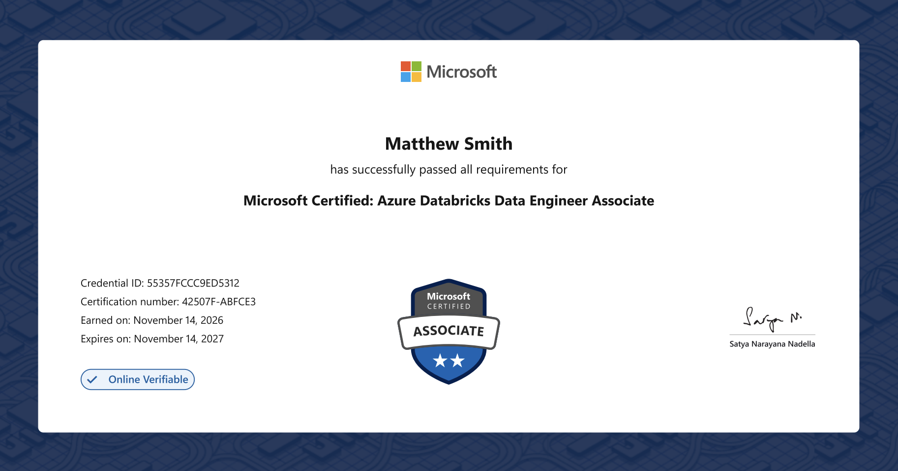

 

MICROSOFT FABRIC &nbsp;&nbsp;·&nbsp;&nbsp; AZURE DATABRICKS &nbsp;&nbsp;·&nbsp;&nbsp; LAKEHOUSE ARCHITECTURE

  

&nbsp;

 

---

### A B O U T

Data engineer specializing in Microsoft Fabric. I design and build Lakehouse platforms and automated pipelines that turn raw operational data into trusted, analytics-ready datasets.

I partner with stakeholders to define data requirements, assess existing environments, and deliver solutions built for quality, reliability, and maintainability.

---

### E D U C A T I O N

<table>
<tr>
<td width="40%"><b>M.S. Software Engineering</b></td>
<td width="35%">Western Governors University</td>
<td width="25%" align="right">2026</td>
</tr>
<tr>
<td><b>B.S. Software Engineering</b></td>
<td>Western Governors University</td>
<td align="right">2024</td>
</tr>
</table>

---

### C E R T I F I C A T I O N S

<table>
<tr>
<td width="50%" align="center" valign="top">

**Fabric Data Engineer Associate** 
EARNED NOV 2026 &nbsp;·&nbsp; ID EC1D51A62089AD0F 
<a href="https://learn.microsoft.com/api/credentials/share/en-us/matthewmsmith/EC1D51A62089AD0F?sharingId=20BBBECC2D103AB"><b>VERIFY ON MICROSOFT LEARN ↗</b></a>

</td>
<td width="50%" align="center" valign="top">

**Azure Databricks Data Engineer Associate** 
EARNED NOV 2026 &nbsp;·&nbsp; ID 55357FCCC9ED5312 
<a href="https://learn.microsoft.com/api/credentials/share/en-us/matthewmsmith/55357FCCC9ED5312?sharingId=20BBBECC2D103AB"><b>VERIFY ON MICROSOFT LEARN ↗</b></a>

</td>
</tr>
</table>

Click any certificate to verify its validity directly with Microsoft.
  
ADDITIONAL — CompTIA Security+ &nbsp;·&nbsp; Certified SAFe® 6 Agilist

---

### T O O L K I T

  

LAKEHOUSE &nbsp;·&nbsp; MEDALLION ARCHITECTURE &nbsp;·&nbsp; PIPELINE ORCHESTRATION &nbsp;·&nbsp; API + ERP INTEGRATION &nbsp;·&nbsp; DATA QUALITY

---

### A R C H I T E C T U R E

<table>
<tr>
<td width="33%" align="center" valign="top">

**BRONZE** 
Raw data landed from ERP systems, APIs, and files, kept as-is for traceability

</td>
<td width="33%" align="center" valign="top">

**SILVER** 
Cleaned, validated, and conformed to shared definitions

</td>
<td width="33%" align="center" valign="top">

**GOLD** 
Business-ready models for analytics and reporting

</td>
</tr>
</table>

---

### E X P E R I E N C E

<table>
<tr>
<td width="40%"><b>Data Engineering Consultant</b></td>
<td width="35%">Quisitive</td>
<td width="25%" align="right">OCT 2026 — PRESENT</td>
</tr>
<tr>
<td colspan="3">End-to-end Microsoft Fabric solutions: Lakehouse, Data Factory pipelines and transformations. Client discovery, environment assessment and platform architecture.</td>
</tr>
<tr>
<td><b>Fabric Data Engineer II</b></td>
<td>VSolvit</td>
<td align="right">APR 2025 — OCT 2026</td>
</tr>
<tr>
<td colspan="3">Medallion Architecture in Fabric with notebooks. Automated OData API ingestion with Google Drive delivery. Secrets secured with Azure Key Vault. Q3 Impact Award, 2026.</td>
</tr>
<tr>
<td><b>Software Engineer I</b></td>
<td>VSolvit</td>
<td align="right">AUG 2024 — APR 2025</td>
</tr>
<tr>
<td colspan="3">Built database-backed applications on SQL Server. Developed an AI-powered HR assistant using embeddings and retrieval-augmented generation, reducing HR inquiries by 32%.</td>
</tr>
</table>

 

D E S I G N &nbsp;&nbsp; · &nbsp;&nbsp; B U I L D &nbsp;&nbsp; · &nbsp;&nbsp; D E L I V E R

